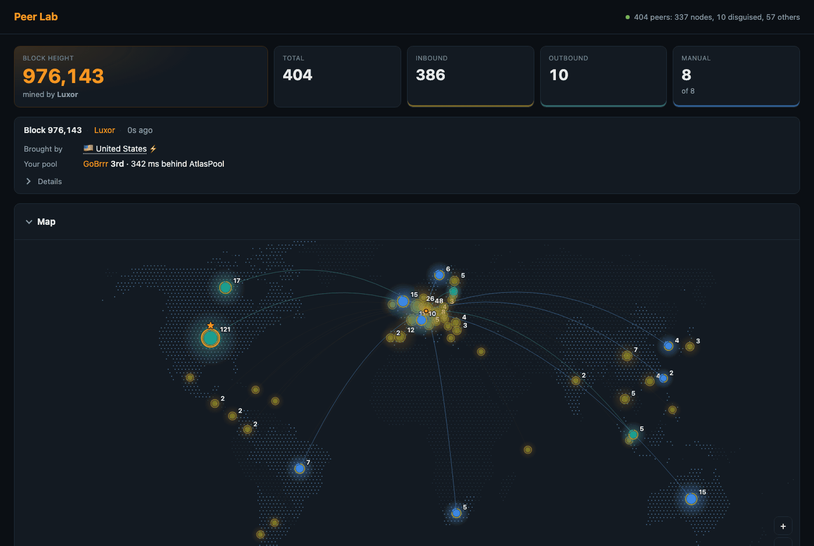
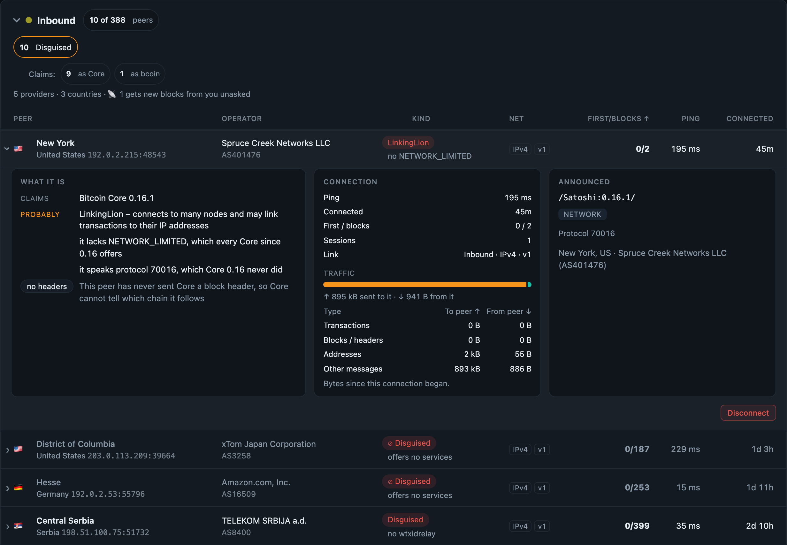
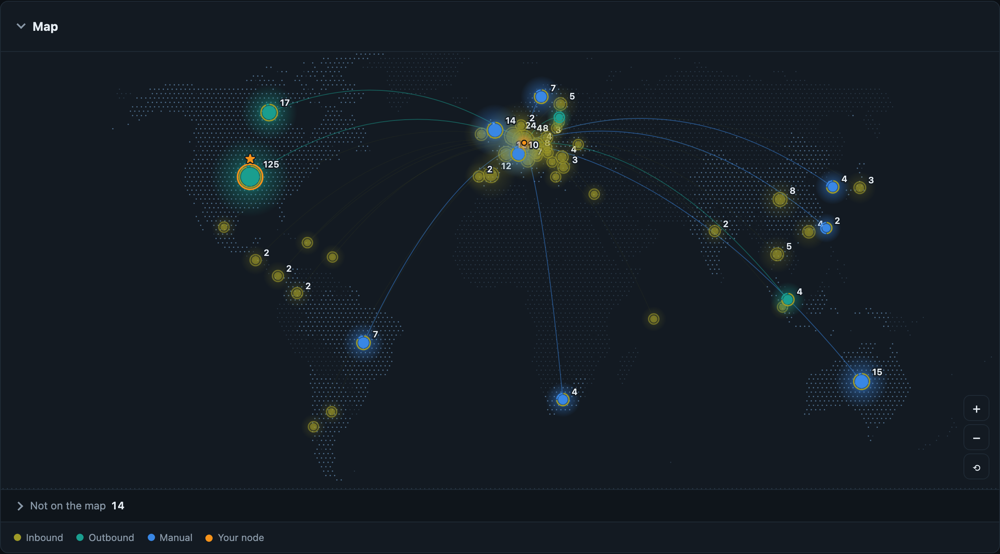
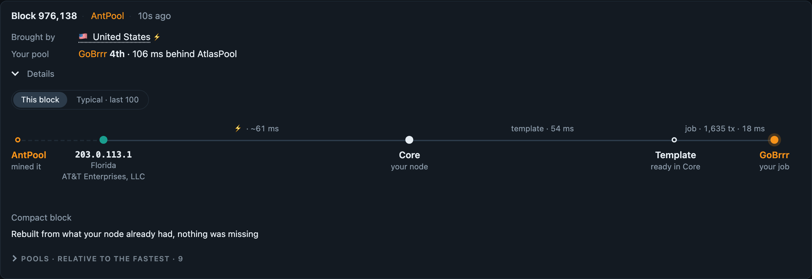
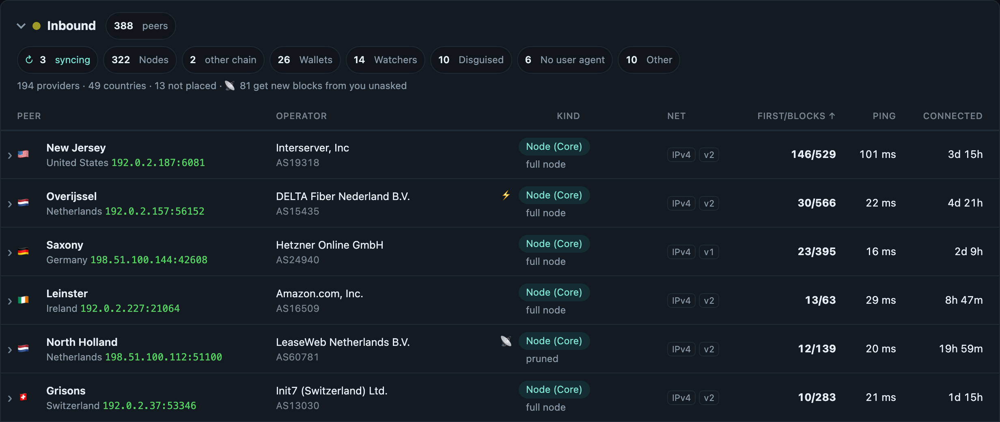
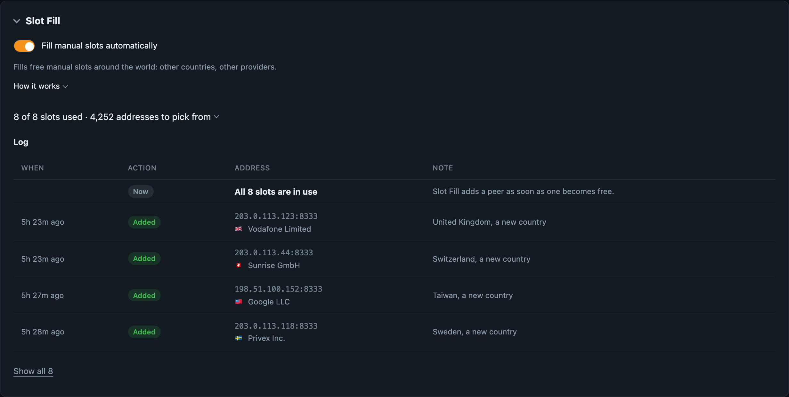
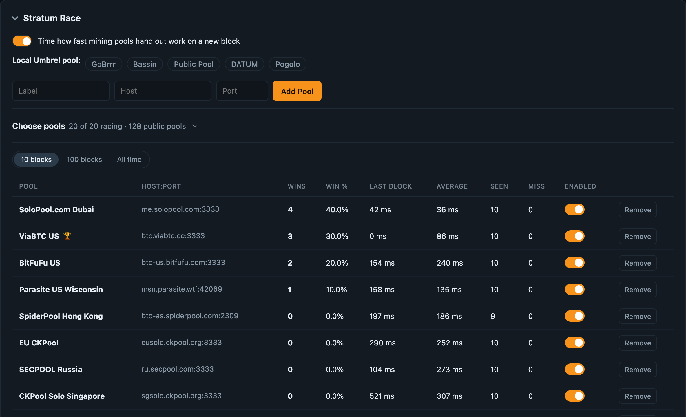

<p align="center">
  
</p>

<h1 align="center">Peer Lab</h1>

<p align="center">
  <b>Who your node talks to, and who brings it blocks first.</b><br>
  An Umbrel app for the peers of your Bitcoin node.
</p>

<p align="center">
  <a href="https://github.com/benunskilled/peer-lab/actions/workflows/ci.yml"></a>
  <a href="https://github.com/benunskilled/peer-lab/releases"></a>
  
  <a href="LICENSE"></a>
</p>

<p align="center">
  
</p>

<p align="center">
  <a href="https://peermap.xyz/"><b>Try the live demo →</b></a><br>
  <sub>One node's Peer Lab with ten recorded blocks. Every address is replaced.</sub>
</p>

Your node talks to strangers all day. Each one says what software it runs, but is it telling the truth? Peer Lab takes a closer look: what a peer offers, whether it wants your transactions, which chain it is on. A normal node, a wallet, a crawler, or a spy in disguise? The map shows where they are and who hosts them.

Every new block reaches your node through one of these peers. Peer Lab notes for every block who was first, and each peer carries its count, like 43 of 1,693 blocks. Open a peer to see everything else: its traffic, what it announced, and the buttons to keep it or let it go.

Core has eight manual slots it never fills on its own. Slot Fill uses them for spread: other regions, other providers. Stratum Race times how fast your own pool turns a new block into fresh work, next to public pools. Both are off by default, and Peer Lab sends no peer address to any outside service.

<p align="center">
  <a href="#who-they-are">Who they are</a> ·
  <a href="#where-they-are">Where they are</a> ·
  <a href="#who-brings-blocks-first">Who brings blocks first</a> ·
  <a href="#slot-fill">Slot Fill</a> ·
  <a href="#stratum-race">Stratum Race</a> ·
  <a href="#install">Install</a>
</p>

## Who they are

A name is easy to fake. Behaviour is harder. Peer Lab catches, for example, an ancient "Bitcoin Core" offering encryption that Core only got years later, a "Sat0shi" written with a zero, and a "Bitcoin Core" that keeps asking for your addresses, like a crawler would.

Every peer gets a label, from Core and Knots nodes to pool nodes, wallets, crawlers, research scanners and disguised peers. Open a peer to see why it got its label. Some disguised peers even have a name: [LinkingLion](https://b10c.me/observations/06-linkinglion/), which may link transactions to the IP addresses they came from, gets its own red pill.



It is a best guess from what one node can see, so a label can be wrong. Know better about one? [Open an issue](https://github.com/benunskilled/peer-lab/issues) and I will happily fix it.

How sure a label is shows in its first words:
- No prefix: the name is in the project's own code or setup.
- "Probably": something technical points there, but the name alone is no proof.
- "Named like": only the name matches.

## Where they are

Zoom from countries down to regions and click one to filter the tables. Your connections come in three groups: the manual peers, the outbound peers Core picked for you, and the inbound peers that found you on their own.

Peers spread across the world can still all live at one hosting company. If that company goes down, so do they. Sort by operator and you see it right away. Tor, I2P and CJDNS peers don't reveal where they sit, so they are listed under the map.



## Who brings blocks first

For each new block, Peer Lab names the pool that mined it, when it can tell, and the peer that brought it to you. Core doesn't say who delivered a block, so Peer Lab works it out from Core's per-peer block times. When more than one peer matches, nobody gets the point. On my node that is rare. Open the details and you see whether Core had to ask for missing transactions. With Stratum Race on, you also see the whole way with times: from the pool to your peer, to Core, and to your own pool's mining job.



*First/Blocks* counts the blocks a peer brought first, out of all the blocks it was connected for: 38/208 means 38 of 208, and a green address has brought at least one. ⚡ marks your high-bandwidth peers: the up to three that Core has asked to send new blocks straight away.



## Slot Fill

Turn on Slot Fill and your node gets up to eight extra outgoing connections, to peers in places its own connections don't reach. It works without an open port, and Core keeps managing its regular peers as usual.

A free slot goes to the region where your node has the fewest connections, and to an operator it does not use yet, where it can tell. Slot Fill picks the peer from Core's address book, and Core tries the connection. A peer that passes keeps its slot. Every step lands in the log, with the reason.



The padlock keeps a peer even when it goes offline, once Core has connected to it. Add one by hand, or lock one from the table, and Slot Fill leaves it alone.

## Stratum Race

Switch on Stratum Race and add your own pool. If GoBrrr, Bassin, Public Pool, DATUM or Pogolo runs on your Umbrel, Peer Lab offers to add it for you. Public pools, solo and shared, from around the world race alongside, up to 20 at once. No miner needed.

For every new block, the first pool to send fresh work sets the reference time and the others are timed against it. You see who wins, how far behind the rest are, and whether your own pool gets faster as you tune your setup. Peer Lab connects like a miner but never submits shares.



## Quiet and local

No peer address goes to any outside service: the map, the locations and the operators are built into the app. Peer Lab talks to Core through RPC and ZMQ and changes only live connections and the `addnode` list. It never touches `bitcoin.conf`, wallets, keys or block files. More in [SECURITY.md](SECURITY.md).

On my node, with about 400 peers, Peer Lab uses about 230 MB of RAM across its five services and almost no CPU, and its database grows by about 5 MB a day.

## Install

1. Add the [Bitcoin Peer Lab community store](https://github.com/benunskilled/bitcoin-lab-community-store) on Umbrel.
2. Install **Peer Lab**. It requires the official **Bitcoin Node** app.
3. Open it from Umbrel or at `<your-umbrel>:8797`.

On a typical node you'll first see about ten outbound peers, and inbound ones once other nodes reach you, over an open port or Tor. The block counts start with the next new block.

Tested with Bitcoin Core 32.1.

### Coming from Bitcoin Lab or Peer Map

Peer Lab replaces both. Switch off Bitcoin Lab's Slot Fill, install Peer Lab, then uninstall Bitcoin Lab and Peer Map. Peer Lab keeps the manual peers already set in Core that connect, but starts with its own data; nothing is imported.

## Development

```sh
cd app && npm ci && PEERS_DIR=../peers npm test
cd ../peers && go test ./...
```

- `app/` – the page, block measurements, Slot Fill and Stratum Race (Node)
- `peers/` – the peer list, places and labels (Go), served under `/peers/`
- `Dockerfile` – one image for all five services

CI also runs both against real Bitcoin Core on regtest and loads the page in a browser. A version tag builds the image for amd64 and arm64, runs it on both and prints the reference with tag and digest for the store entry. Settings: [app/docs/configuration.md](app/docs/configuration.md).

## Data and licence

MIT, see [LICENSE](LICENSE).

- Geolocation and operators: [DB-IP](https://db-ip.com) Lite databases, CC BY 4.0
- World map: [Natural Earth](https://www.naturalearthdata.com), public domain
- Tor exits: the Tor Project's [bulk exit list](https://check.torproject.org/torbulkexitlist)
- Mining pools: [mempool/mining-pools](https://github.com/mempool/mining-pools) and [bitcoin-data/mining-pools](https://github.com/bitcoin-data/mining-pools), MIT

Versions and update steps: [peers/geo/SOURCE.md](peers/geo/SOURCE.md), [peers/asn/SOURCE.md](peers/asn/SOURCE.md), [peers/torexit/SOURCE.md](peers/torexit/SOURCE.md), [app/src/data/](app/src/data/).
